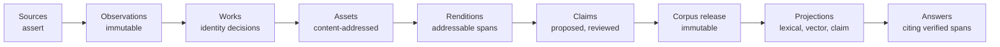

# Lab AI Assistant

**Internal use only.** There is no public query endpoint and no self-registration.
Every route requires an authenticated member of a workspace.

Lab AI Assistant is an internal research-evidence platform. Lab members discover,
acquire, parse, extract, review, search, and synthesise external literature and
internal research material — and every answer cites an immutable evidence span
rather than a row that might have changed since.

The central object is a **versioned, policy-controlled evidence graph**:



In this vocabulary **ingestion means only the final promotion of an approved
corpus release into serving indexes**. Discovery, acquisition, parsing, extraction,
review, and export are separate stages with separate contracts.

## Where to read next

| You are | Start here |
|---|---|
| A researcher | [Asking and citations](docs/product/asking-and-citations.md) |
| A data steward | [Collections and releases](docs/product/collections-and-releases.md) |
| A developer | [Architecture](docs/architecture/system-context.md), [Contributing](CONTRIBUTING.md) |
| A connector owner | [Connector SDK](docs/connectors/README.md) |
| An operator | [Deployment](docs/operations/deployment.md), [Runbooks](docs/operations/runbooks/README.md) |
| A security reviewer | [Threat model](docs/security/threat-model.md) |
| Anyone | [Documentation index](docs/README.md) |

Durable decisions live in [ADRs](docs/architecture/adr/). Plans and READMEs link to
them rather than restating their reasoning.

## Prerequisites

| Tool | Version | Notes |
|---|---|---|
| Python | 3.12 | 3.13 is not supported yet |
| Node.js | 22 or newer | web application only |
| Docker | 24 or newer | PostgreSQL 16 with pgvector |
| PostgreSQL | 16 with pgvector 0.7+ | supplied by the compose file |

## Quick start

Every command below runs in CI through the documentation smoke test.

```bash
cp .env.example .env
```

```bash
python3.12 -m venv .venv
```

```bash
.venv/bin/pip install -e "packages/python[dev,parsers]" -e services/api
```

The whole test suite is offline. It uses in-memory adapters, fixture-keyed fake
connectors, a fake model provider, and SQLite for the SQL adapter — no network, no
database, no shared state:

```bash
.venv/bin/pytest -q
```

```bash
.venv/bin/ruff check .
```

See the stack work end to end without any infrastructure:

```bash
.venv/bin/lab demo
```

Inspect the effective configuration, with the source of every key and secrets
reduced to a digest:

```bash
.venv/bin/lab config print
```

### Running against PostgreSQL

```bash
docker compose up -d db
```

```bash
cd database && alembic upgrade head
```

```bash
.venv/bin/uvicorn lab_assistant_api.main:app --factory --reload --port 8000
```

```bash
.venv/bin/lab worker network
```

```bash
.venv/bin/lab worker compute
```

### The web application

```bash
cd apps/web && npm install
```

```bash
npm run dev
```

```bash
npm test -- --run
```

```bash
npm run type-check
```

### Everything in containers

```bash
docker compose up -d --build
```

## Configuration

One variable names the scenario; everything else derives from it.

```text
LAB_ENV = local | compose | server
```

| File | Contains | In git |
|---|---|---|
| `.env` | secrets and behaviour. **No hostnames, ports, or URLs.** | no |
| `.env.compose` | addresses for containers on a dev machine | yes |
| `.env.server` | addresses for the deployment VM | yes |
| `infra/environments/<env>.yaml` | behaviour per scenario, no secrets | yes |

Loading order, lowest precedence first: compiled defaults, the versioned
environment file, workspace config records in the database, environment variables
for endpoints and secrets, then explicit CLI flags for one invocation.

Because `.env` holds no addresses, `source .env` is safe in any shell. **Never add
a hostname, port, or service URL to `.env`** — that reintroduces the class of bug
where a host process is handed a Compose service name. Each address has exactly one
owner, and no password is duplicated into a `DATABASE_URL`. The reasoning is in
[ADR-0012](docs/architecture/adr/0012-configuration-model.md).

## Operations

Operating the VM goes through `scripts/`:

```bash
./scripts/deploy.sh --dry-run
```

`deploy.sh` fast-forwards from GitHub, rebuilds only the services whose paths
changed, applies migrations, verifies health, and rolls back on failure.
`status.sh`, `logs.sh`, `restart.sh`, and `collect-logs.sh` cover the rest;
`collect-logs.sh` produces a redacted support bundle and refuses to hand one over
if the redaction check fails. Flags and recipes are in
[`scripts/README.md`](scripts/README.md).

## Project status

Under active development, tracking the migration plan from the predecessor
repository. Delivery follows the **M1 milestone first**: retrieval and citation over
verified evidence spans, with the claim graph and datasheet extraction following.
See [the migration overview](docs/migration/README.md) for what is done, what is
next, and what is deliberately deferred.

Supported deployment profile: a single VM running the compose stack, one workspace,
PostgreSQL with pgvector, and no GPU. Tenancy-ready but single-tenant by default —
the cost of shared multi-workspace operation is real and is
[costed rather than assumed](docs/architecture/adr/0006-tenancy-model.md).

## Security

Report a suspected vulnerability privately: see [SECURITY.md](SECURITY.md). Do not
open a public issue, and never paste a credential into one.

## Licence

MIT — see [LICENSE](LICENSE). The dependency set is permissive by policy: a
copyleft dependency is a decision recorded in
[ADR-0011](docs/architecture/adr/0011-parsing-stack-and-licence.md), not a surprise
found later, and CI fails on an unreviewed one.
