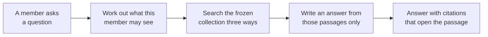
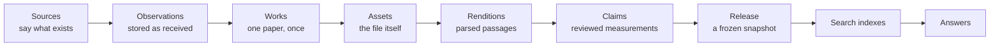

# Lab AI Assistant

**Internal use only.** There is no public page and no sign-up form. Every request
comes from an authenticated member of the lab.

## What it does

Lab members ask research questions in plain language. Answers are built only from
literature and internal documents the lab has collected, and every sentence carries a
citation that opens the exact passage it came from.

It also records what papers actually reported — a lipid yield, a culture temperature,
the strain used — as measurements a person has checked, so the lab can compare results
across dozens of papers without re-reading them.

Three properties separate it from a general-purpose chatbot:

**Answers come only from the lab's collection.** Nothing is answered from a model's
general memory. When the collection does not contain the answer, the application says
so — and it distinguishes *"no document mentions this"* from *"we have not looked
yet"*, which mean very different things to a researcher.

**Citations point at frozen text.** A citation resolves to a specific passage in a
stored copy of a document that cannot change afterwards. Ask the same question in six
months and you can still open exactly what the answer was based on.

**A model proposes; a person decides.** The model reads a paper and suggests a
measurement. A lab member accepts, corrects, or rejects it, and only accepted values
become part of the record. Corrections are kept rather than overwritten, because the
disagreement is useful.

## How it works, briefly

A question becomes an answer in four steps:



The second step comes first on purpose: what a member is allowed to see is decided
*before* anything is searched, so a restricted document cannot influence an answer,
its ranking, or even a total on a chart. The search runs three ways — by keyword, by
meaning, and across checked measurements — and the results are merged.

Getting a document to the point where it can be cited takes several separate stages,
each inspectable and re-runnable on its own:



Each stage is kept separate so that a problem in one is fixed without discarding the
others: a bug in the code that reads a source is fixed by re-reading stored data, not
by asking the source again.

One term to be careful with. **"Ingestion" here means only the last step** — loading
an approved snapshot into the search indexes. Finding, obtaining, parsing, extracting,
reviewing, and exporting are separate stages with separate rules.

The whole design, stage by stage, is in the
[documentation index](docs/README.md), which is written to be read start to finish.

## Where to read next

| You are | Start here |
|---|---|
| A researcher | [Asking and citations](docs/product/asking-and-citations.md) |
| Curating a collection | [Collections and releases](docs/product/collections-and-releases.md) |
| A developer | [Architecture](docs/architecture/system-context.md), [Contributing](CONTRIBUTING.md) |
| Adding a literature source | [Connector guide](docs/connectors/README.md) |
| Running the deployment | [Deployment](docs/operations/deployment.md), [Runbooks](docs/operations/runbooks/README.md) |
| Reviewing security | [Threat model](docs/security/threat-model.md) |
| Anyone | [Documentation index](docs/README.md) |

Durable decisions live in
[architecture decision records](docs/architecture/adr/README.md) — one page per
decision, with its reasoning and the alternatives that were rejected. Other pages link
to them rather than restating them.

## Words used throughout

Short definitions, so the rest of this file and the code read the same way.

| Term | Meaning |
|---|---|
| **Workspace** | One lab's separate space. Every record belongs to exactly one, and nothing crosses between them. |
| **Work** | One scholarly item — a paper, a dataset — regardless of how many sources mention it or how many files it has. |
| **Asset** | An actual file, stored under a fingerprint of its own content so a swapped or corrupted copy is detected. |
| **Rendition** | A parsed document: sections, paragraphs, and tables that can be pointed at individually. |
| **Passage** (a "span") | The exact stretch of text a citation resolves to. |
| **Claim** | A measurement a paper reported, with its units and conditions, and the passage that states it. |
| **Release** | A frozen, versioned snapshot of the collection. Questions are answered from a release, never from work in progress. |
| **Collection** (a "scope") | A living definition of what literature the lab wants: queries, sources, date ranges, and rules. |
| **Steward** | The role that curates collections and publishes releases. |
| **API** | Application programming interface: the service the web application and command line talk to. All the rules live there. |
| **Connector** | The adapter for one outside source, such as PubMed or Crossref. |
| **DOI** | Digital Object Identifier: the permanent identifier printed on most papers, and the strongest signal that two records are the same work. |

## Prerequisites

| Tool | Version | Notes |
|---|---|---|
| Python | 3.12 | 3.13 is not supported yet |
| Node.js | 22 or newer | web application only |
| Docker | 24 or newer | runs the database for you |
| PostgreSQL | 16 with pgvector 0.7 or newer | supplied by the Docker Compose file, so there is nothing to install by hand |

**pgvector** is the PostgreSQL extension that stores the numeric representations used
for similarity search, and searches them. Keeping it inside PostgreSQL means there is
no second database to operate.

## Quick start

Every command below is checked automatically on each change, so none of them is
stale. You can follow them in order.

**You do not need a database, a network connection, or any credentials to run the
tests or the demo.** That is deliberate: the test suite uses in-memory stand-ins for
the database and file storage, recorded fixture responses instead of real literature
sources, and a deterministic stand-in for the language model. Nothing reaches the
internet, so the suite behaves the same on every machine.

```bash
cp .env.example .env
```

```bash
python3.12 -m venv .venv
```

```bash
.venv/bin/pip install -e "packages/python[dev,parsers]" -e services/api
```

Run every test — around seven hundred of them, in under a minute:

```bash
.venv/bin/pytest -q
```

Check style and common mistakes:

```bash
.venv/bin/ruff check .
```

See the whole application work end to end with no infrastructure at all. This
publishes a small collection, asks a question, and opens the citation in the answer to
print the evidence behind it. It exits with an error if a citation does not resolve:

```bash
.venv/bin/lab demo
```

Print the settings actually in effect, where each one came from, and which of them are
missing for production. Secrets are shown as fingerprints, never as values, so the
output is safe to paste into a bug report:

```bash
.venv/bin/lab config print
```

See which literature sources this deployment can reach, and whether each has a
credential configured:

```bash
.venv/bin/lab config connectors
```

### Running the real thing locally

Start the database (Docker downloads it the first time):

```bash
docker compose up -d db
```

Create or update its tables:

```bash
cd database && alembic upgrade head
```

Start the service the web application talks to:

```bash
.venv/bin/uvicorn lab_assistant_api.main:app --factory --reload --port 8000
```

Start the background workers, in two more terminals. They are split by what they do:
one talks to the outside world, the other does the heavy local work — including
reading documents. The coordinator needs database and storage network access:

```bash
.venv/bin/lab worker network
```

```bash
.venv/bin/lab worker compute
```

### The web application

Install its dependencies, then start it on <http://localhost:3002/assist>:

```bash
cd apps/web && npm install
```

```bash
npm run dev
```

```bash
npm test -- --run
```

```bash
npm run type-check
```

### Everything in containers

```bash
docker compose up -d --build
```

## Configuration

One variable names the scenario; everything else derives from it.

```text
LAB_ENV = local | compose | server
```

| File | Contains | In git |
|---|---|---|
| `.env` | secrets and behaviour. **No hostnames, ports, or URLs.** | no |
| `.env.compose` | addresses for containers on a dev machine | yes |
| `.env.server` | addresses for the deployed server | yes |
| `infra/environments/<env>.yaml` | behaviour per scenario, no secrets | yes |

Settings are read in this order, each overriding the one before: values compiled into
the code, the versioned file for the chosen scenario, per-workspace settings stored in
the database, environment variables for addresses and secrets, and finally a
command-line flag for a single run.

Because `.env` holds no addresses, `source .env` is safe in any shell. **Never add
a hostname, port, or service URL to `.env`** — that reintroduces the class of bug
where a host process is handed a Compose service name. Each address has exactly one
owner, and no password is written twice. The reasoning is in
[decision record 0012](docs/architecture/adr/0012-configuration-model.md).

## Operations

Running the deployed server goes through the scripts in `scripts/`, never through
hand-typed Docker commands. Start with a dry run, which reports what *would* change:

```bash
./scripts/deploy/update.sh --check
```

Run it as root (`sudo`). `scripts/deploy/update.sh` pulls the new code, rebuilds the images while the old
version keeps serving, applies pending migrations, and checks the application is
healthy. It does not put the previous version back on failure: after a migration that
would run old code on a new schema, so it stops and says what to inspect instead. `status.sh`, `logs.sh`, and `restart.sh` cover day-to-day work.
`collect-logs.sh` produces a support bundle for a bug report: it removes anything
secret, then checks its own output and refuses to hand the bundle over if it finds
something. Every flag is listed in [`scripts/README.md`](scripts/README.md), and each
situation an operator might face has a page under
[runbooks](docs/operations/runbooks/README.md).

## Project status

Under active development, replacing an earlier version of the same idea. The first
milestone — asking questions and getting answers whose citations resolve to verified
passages — is complete. Recording reviewed measurements and exporting them is built
and tested; what remains there is real templates and real reviewer time. See
[the migration overview](docs/migration/README.md) for what is done, what is next, and
what is deliberately postponed.

What it is designed to run on: one virtual machine, one lab, PostgreSQL, and no
graphics card. It is built so that several labs *could* share an installation, but it
runs as one by default, because the cost of sharing is real and is
[weighed rather than assumed](docs/architecture/adr/0006-tenancy-model.md).

## Security

Report a suspected vulnerability privately: see [SECURITY.md](SECURITY.md). Do not
open a public issue, and never paste a credential into one.

## Licence

MIT — see [LICENSE](LICENSE). Every dependency is permissively licensed by policy, so
the lab can use, adapt, and share this without a licence review each time. Choosing a
dependency with a more restrictive licence is a recorded decision
([record 0011](docs/architecture/adr/0011-parsing-stack-and-licence.md)) rather than
something discovered later, and the automated checks fail on an unreviewed one.
