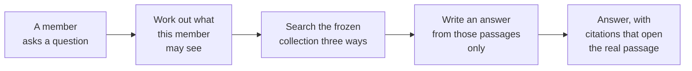
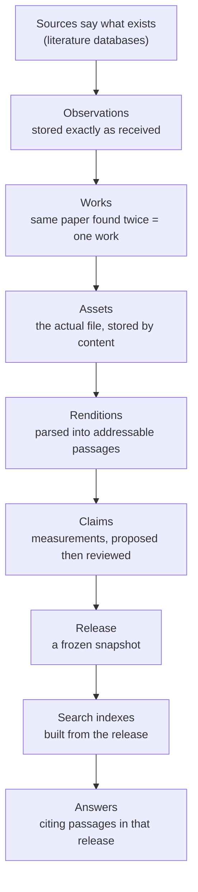
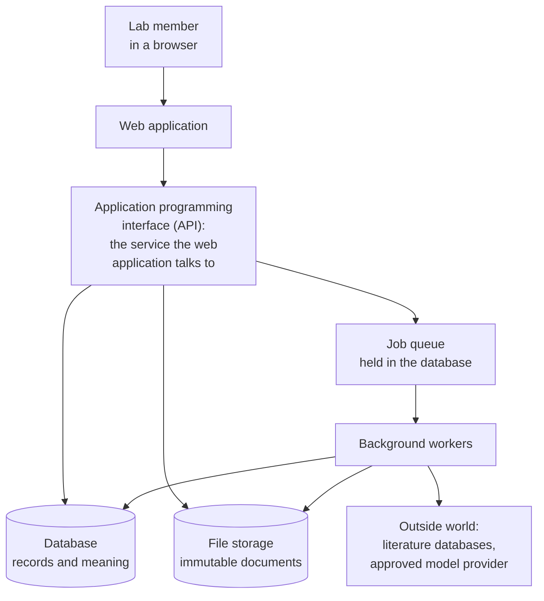

# Documentation

This index is the map, and it is also the introduction. It explains what the
application does, then how it is built, then where to read more about each part.

Every page in the documentation is reachable from here — an orphan page is a page
nobody maintains, and the documentation check fails on one. Each page other than this
one carries a header saying who owns it, when it was last verified, and which code it
describes. Where a page and the code disagree, the code wins and the page is a bug.

---

## 1. What the application does

Lab members ask research questions in plain language and get answers built only from
literature and internal documents the lab has collected. Every sentence in an answer
carries a citation, and clicking that citation opens the exact passage it came from.

Three things make this different from a general-purpose chatbot:

**It only uses the lab's own collection.** Nothing is answered from a model's general
memory. If the collection does not contain the answer, the application says so
instead of guessing — and it distinguishes *"no document mentions this"* from *"we
have not looked yet"*, which are very different facts to a researcher.

**Every citation points at frozen text.** A citation resolves to a specific passage
in a specific stored copy of a document, which cannot change afterwards. Ask the same
question in six months and you can still open exactly what the answer was based on.

**Numbers from papers are checked by a person before anyone can rely on them.** The
model reads a paper and *proposes* a measurement — a lipid yield, a temperature. A
lab member accepts, corrects, or rejects it. Only accepted values become part of the
searchable record.

The application is internal. There is no public page, no sign-up form, and every
request comes from an authenticated member of the lab.

### The five things a lab member does

| Task | What it means | Read more |
|---|---|---|
| **Ask** | Ask a question, read the answer, open its citations | [Asking and citations](product/asking-and-citations.md) |
| **Collect** | Define what literature the lab wants, and gather it | [Collections and releases](product/collections-and-releases.md) |
| **Review** | Accept, correct, or reject measurements the model proposed | [Review workflows](product/review-workflows.md) |
| **Export** | Take a dataset out, with the evidence attached | [Export guide](product/export-guide.md) |
| **Look around** | See what the collection contains, by year, journal, or source | [Product overview](product/overview.md) |

Who is allowed to do which of these is set by role: [user roles](product/user-roles.md).

---

## 2. How a question becomes a cited answer

This is the whole application in one sequence.

**Work out what this member may see — first, before anything is searched.** Some
material is restricted to a group, or licensed in a way that limits how much can be
shown. That decision is made before the search runs, so a document a member may not
open cannot influence the answer, the ranking, or even the totals on a chart.

**Search three ways.** By keyword, by meaning (a "similarity search", which finds
passages that say the same thing in different words), and across reviewed
measurements. The three result lists are then merged.

**Write the answer from those passages only.** The model is given the retrieved
passages and told plainly that they are documents, not instructions — so a sentence
inside a paper saying "ignore your instructions" is treated as text, not as a
command.

**Return citations that resolve.** Each citation is an opaque token the server
issued, not a database identifier, so it discloses nothing if shared and cannot be
guessed. If the model cites something the server did not give it, the answer is shown
with a warning rather than silently cleaned up: a citation you can see is wrong is
safer than one quietly removed.

Details: [search and answering](architecture/search-and-rag.md).

---

## 3. How a document becomes citable evidence

Before a question can be answered, material has to be found, obtained, read, and
frozen. Each step below is separate on purpose: it can be inspected, re-run, and
corrected without discarding the others.

| Step | What happens, and why it is its own step |
|---|---|
| **Sources** | Public literature databases are asked what exists. They disagree with each other about dates, licences, and identifiers — so what each one *said* is kept separately rather than merged into a single "truth". See [connectors](connectors/README.md) and the [source matrix](connectors/source-matrix.md). |
| **Observations** | Each source's answer is stored byte-for-byte before anything interprets it. If the code that reads a source has a bug, it is fixed by re-reading stored data instead of asking the source again. See [source observations](data-contracts/source-observations.md). |
| **Works** | Deciding that two records describe the same paper. Merging happens **only** on a strong identifier such as a Digital Object Identifier (DOI, the permanent identifier printed on most papers). Similar titles only *suggest* a match for a person to confirm, because corrections, translations, and conference versions share titles. See [work identity](data-contracts/work-identity.md). |
| **Assets** | Obtaining the file itself, by the best route the licence permits, and storing it under a fingerprint of its own content. When no automatic route is allowed, the application asks a person to supply a copy they are entitled to — a normal outcome, not a failure. See [assets and rights](data-contracts/assets-and-rights.md). |
| **Renditions** | Reading the file into labelled, addressable pieces: sections, paragraphs, tables with real rows and columns. A citation later points into this. If the text quality is too poor, the document is marked degraded and no measurements are taken from it. See [renditions and passages](data-contracts/renditions-and-spans.md). |
| **Claims** | Measurements with their units, conditions, and the passage that states them — proposed by the model, then accepted, corrected, or rejected by a person. Corrections are kept as new versions; nothing is overwritten. See [claims](data-contracts/entities-experiments-claims.md). |
| **Release** | Freezing all of the above into an immutable snapshot with a version. Questions are answered from a release, never from work in progress, so the same question gives the same answer. See [corpus release](data-contracts/corpus-release.md). |
| **Search indexes** | Built from a release. Building a new release copies the parts that did not change, so publishing costs the size of the change rather than the size of the collection. |

One word to be careful with: **"ingestion"** in this project means *only* the final
step of loading an approved release into the search indexes. It does not mean the
whole pipeline. The full glossary is in [terminology](data-contracts/terminology.md).

---

## 4. How the software is arranged

Five running pieces, each with one job:

- **The web application** is the interface. It holds no rules of its own — it asks
  the service and displays the answer. Sign-in credentials never reach the browser's
  storage.
- **The service (the API)** is where every rule lives: who may see what, what a valid
  citation is, when a release may be published.
- **The database** stores records and their meaning, including the job queue. There is
  no separate queue system to operate.
- **File storage** holds documents and other large files, each addressed by a
  fingerprint of its content, so a corrupted or swapped file is detected rather than
  read.
- **Background workers** do the slow and risky work: contacting outside sources,
  reading untrusted documents, building indexes. In production the worker that reads
  documents has **no network access at all**, which is a deliberate safety measure
  rather than a side effect.

Long jobs are rows in the database, not messages in flight. A job records what it is
waiting for, how many times it has been tried, and who asked for it — so "why is this
document not indexed yet" always has an answer you can read.
See [task orchestration](architecture/task-orchestration.md).

More: [system context](architecture/system-context.md) ·
[containers and deployment](architecture/containers-and-deployment.md) ·
[code structure](architecture/modules-and-dependencies.md) ·
[provenance](architecture/provenance.md)

---

## 5. The rules the design is built around

These are enforced by tests, not by good intentions.

| Rule | Why |
|---|---|
| Visibility is decided before searching, and again after ranking | A result someone may not open must not shape what they see, and totals must not reveal how much is hidden |
| A published release never changes | A citation that could change is not evidence; a correction is a *new* release, and going back is a pointer change taking seconds |
| A model proposes, a person decides | The model is a fast reader, not an author of record |
| Every citation resolves to a passage that still matches | Checked when a release is published, using a written text-comparison rule that tolerates a publisher's typographic changes but never changes meaning |
| Permission is per action | Being allowed to store a document is not being allowed to display it, and neither is being allowed to send it to an outside model provider |
| An unknown right is a refusal | "We do not know the licence" blocks use and asks a person |
| Failures are specific | Rate-limited, unavailable, not permitted, and awaiting a person are different states with different handling — collapsing them into "failed" loses the information needed to fix anything |

Waiting for a person is a normal state, not an error: it never alerts anyone and
never expires into a failure.

---

## 6. Where to read more

### By audience

| Audience | Start here |
|---|---|
| Scientist or researcher | [Product overview](product/overview.md) · [Asking and citations](product/asking-and-citations.md) · [Review workflows](product/review-workflows.md) |
| Data steward — the person who curates a collection | [Collections and releases](product/collections-and-releases.md) · [Export guide](product/export-guide.md) · [User roles](product/user-roles.md) |
| Developer | [System context](architecture/system-context.md) · [Code structure](architecture/modules-and-dependencies.md) · [Task orchestration](architecture/task-orchestration.md) · [Search and answering](architecture/search-and-rag.md) · [Provenance](architecture/provenance.md) |
| Connector owner — someone adding a new literature source | [Connector guide](connectors/README.md) · [Source matrix](connectors/source-matrix.md) |
| Operator — whoever runs the deployment | [Deployment](operations/deployment.md) · [Monitoring](operations/monitoring.md) · [Support bundles](operations/support-bundles.md) · [Backup and restore](operations/backup-and-restore.md) · [Runbooks](operations/runbooks/README.md) |
| Security or privacy reviewer | [Threat model](security/threat-model.md) · [Data inventory](security/data-inventory.md) · [Sending content to a model provider](security/model-transfer.md) |
| Anyone joining mid-migration | [Migration overview](migration/README.md) · [API compatibility map](migration/api-compatibility.md) · [Audit findings and resolution](migration/remaining-implementation-tasks.md) · [Follow-up issues](migration/follow-up-implementation-issues.md) |

### Data contracts

The vocabulary is precise, and these pages are the definitions:

- [Terminology](data-contracts/terminology.md) — every term, one meaning each
- [Source observations](data-contracts/source-observations.md) — what a source said, and when
- [Work identity](data-contracts/work-identity.md) — deciding two records are one paper
- [Assets and rights](data-contracts/assets-and-rights.md) — files, licences, and what each permits
- [Renditions and passages](data-contracts/renditions-and-spans.md) — parsed documents and citable spans
- [Entities, experiments, claims](data-contracts/entities-experiments-claims.md) — strains, conditions, measurements
- [Corpus release](data-contracts/corpus-release.md) — the frozen snapshot
- [Export package](data-contracts/export-package.md) — what leaves, and with what provenance
- [State and error taxonomy](data-contracts/state-and-error-taxonomy.md) — every state and failure, and what each means

### Decisions

[Architecture decision records](architecture/adr/README.md) — one page per durable
decision, each with the reasoning and the alternatives that were rejected. An
accepted record is immutable apart from its status and links; a changed decision is a
new record that supersedes the old one.

### Evaluation

How answer quality and retrieval quality are measured, and which numbers must hold
before a release may be published:

- [Methodology](evaluation/methodology.md)
- [Release gates](evaluation/release-gates.md)

### Extraction templates

A template defines what to look for in a paper and what counts as evidence:

- [How templates are documented](extraction-templates/README.md)
- [Yeast lipid datasheet](extraction-templates/yeast-lipid-datasheet.md) — the worked example

### Contributing

- [Review ownership](contributing/review-ownership.md) — who reviews what, and what to look for
- [Root CONTRIBUTING.md](../CONTRIBUTING.md) — the definition of done
