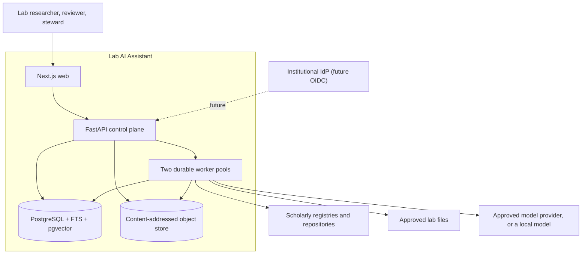

Status: active
Owner: technical owner
Last verified: 2026-08-12
Source of truth: `packages/python/lab_assistant/`, `docker-compose.yml`

# System context

## Boundaries that matter

**The browser never holds a token.** It talks to same-origin Next.js routes, which
attach the session cookie server-side (ADR-0016).

**Only workers reach outward.** The API makes no scholarly-source request and no
model call on a user's request path except answer generation; everything else is a
durable task. A parsing worker has *no* network at all in production, because a
parser that needs the network is doing something it should not.

**Object storage holds bytes; PostgreSQL holds meaning.** Raw source responses,
acquired assets, rendition payloads, model envelopes, and export packages are
objects addressed by digest. Every database row that refers to one carries the digest,
so integrity is checkable without trusting the store.

**The model is on the far side of a policy gate.** Content reaching an external
provider has passed a rights decision for `send_to_external_model` and the
model-transfer policy, evaluated once when the task is created and again immediately
before the call.

## Containers

| Container | Responsibility |
|---|---|
| `web` | interface; same-origin proxy; no domain logic |
| `api` | control plane, retrieval, answer generation, policy decisions, upload scanning |
| `worker-network` | discovery, acquisition, extraction |
| `worker-compute` | parsing, indexing, evaluation |
| `db` | control plane, task DAG, audit, FTS, pgvector |
| object store | immutable payloads and packages |

Further reading: [containers and deployment](containers-and-deployment.md),
[modules and dependencies](modules-and-dependencies.md),
[task orchestration](task-orchestration.md), [search and RAG](search-and-rag.md),
[provenance](provenance.md).
