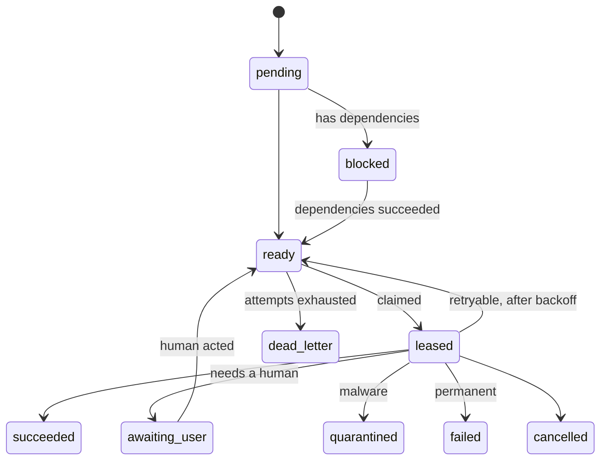

Status: active
Owner: technical owner + operator
Last verified: 2026-08-12
Source of truth: `packages/python/lab_assistant/domain/tasks.py`, `application/tasks.py`

# Task orchestration

## The shape

A task row records stage, state, input fingerprint, inputs, dependencies, attempt,
lease owner and expiry, heartbeat, eligibility time, error class, and result. Claiming
uses `FOR UPDATE SKIP LOCKED`. There is no broker (ADR-0005).

## Properties worth knowing

**Idempotent submission.** Two submissions of the same command share a fingerprint and
are one task. The fingerprint covers stage, workspace, inputs, config versions, policy
version, and the handler's implementation version — so a handler change invalidates
correctly.

**Idempotent execution.** A completed task returns its stored result rather than
re-running. At-least-once delivery therefore has one logical effect.

**A human wait is not a failure.** `awaiting_user` holds no lease, does not count
toward failure metrics, and does not age into a dead letter. Assisted acquisition is
the common case.

**Retries are per error class.** A rate limit waits for the stored `Retry-After`; a
policy block never retries; malware quarantines; an exhausted retryable failure
dead-letters *and is audited*, so it cannot exhaust invisibly.

**Concurrency is capped per stage, in the database.** Not by replica count. This is
the fix for the predecessor's in-memory rate state, where a long provider call in a
shared worker starved the other queue.

**Progress is read from rows.** Completion is never inferred from a missing heartbeat.

## Which stages schedule what

Handlers return follow-on work; the orchestrator submits it. Two links are
deliberately *not* automatic:

- **discovery does not schedule reconciliation.** One connector finishing says nothing
  about the others; reconciling early would resolve identity against a partial
  observation set and then be skipped as a duplicate when the rest arrived. Freezing
  the run schedules it, once, over the complete set.
- **indexing does not schedule evaluation.** Which benchmark gates a release, at what
  threshold, is a scientific decision — not a side effect of a projection build.

Review is a human queue, not a stage: validated proposals wait in the queue rather
than becoming a task nobody can execute.
