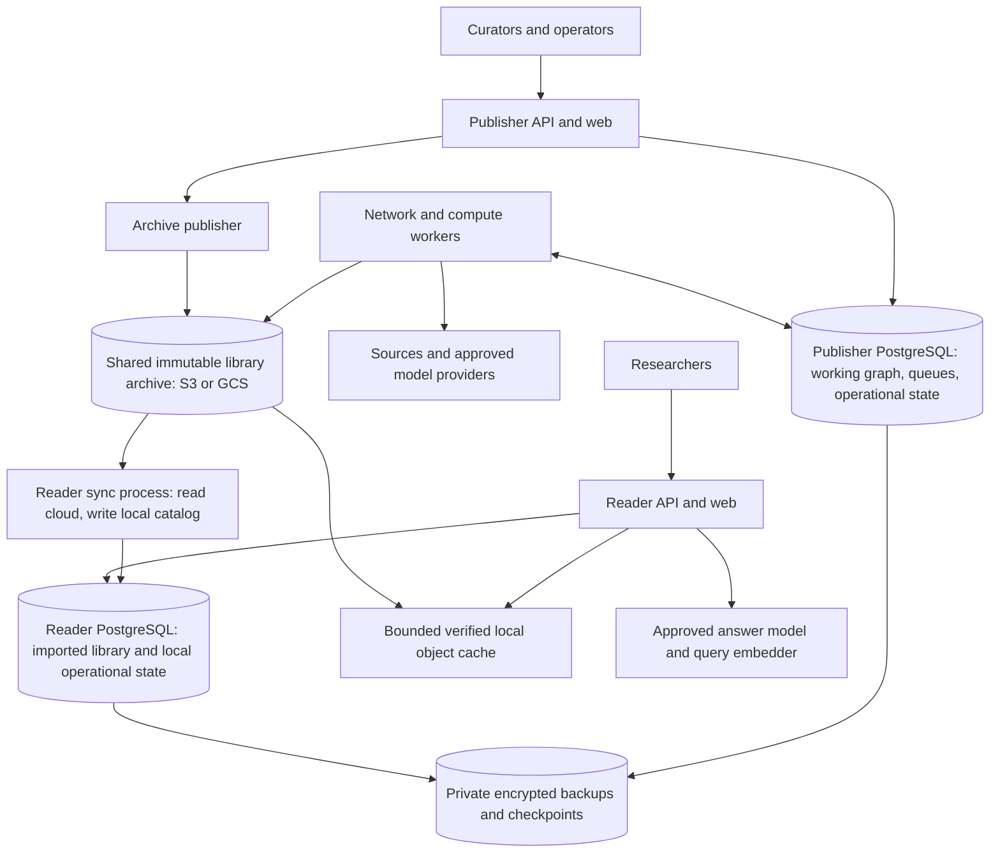

Status: proposed
Owner: technical owner + operator + data steward
Last verified: 2026-11-17
Source of truth: design proposal based on repository commit `927c5ed`; not implemented

# Shared research archive and portable Lab AI Assistant installations

## Read this first

This proposal records the investigation and decisions needed for a later implementation
session. It is specific to **Lab-AI-Assistant**, not BioPipeline2 or Protocols Analysis.
It does not change running services, credentials, storage, or accepted ADRs.

Read together:

1. This document: requirements, alternatives, recommended architecture and operating model.
2. [Code audit](shared-archive-code-audit.md): what actually exists, defects and verification evidence.
3. [Implementation handoff](shared-archive-implementation-plan.md): ordered work, tests, rollout and open decisions.

The user wants expensive acquisitions, parsing, extraction and evaluation results to
survive VM replacement and be reused by multiple installations. One installation may
produce the library while others serve researchers. AWS S3 or Google Cloud Storage
(GCS) should hold durable archival material; databases and remaining local state must
be movable. Publisher and reader roles should be changeable through an operator workflow.
These are goals, not a requirement to use a particular distributed architecture.

**Recommendation:** implement in stages. First harden remote object storage and portable
backups for the existing single installation. Then add a versioned, self-contained
library publication format and independent reader installations with local PostgreSQL
projections. Keep one authoritative publisher per library. Reader installations have
read-only access to the shared library, but writable private operational state.

The bucket must contain both the payloads **and a recoverable, versioned description of
the evidence graph**. Changing `LAB_OBJECT_STORE_KIND` alone does not achieve this.
PostgreSQL remains the query and transaction engine; do not put its live data directory
in an object bucket or issue bucket listings for every search.

## 1. Requirements and boundaries

### Required outcomes

- Move the current VM without re-downloading papers or re-running completed analysis.
- Reuse a completed paper and its permitted derived artifacts on another installation.
- Preserve source observations, acquisition provenance, rights, accepted and rejected
  analysis, review decisions, corrections, citations and evaluation evidence.
- Make newly published research available to reader installations through an explicit
  refresh; avoid half-imported releases and mixtures of incompatible versions.
- Allow a workstation-sized serving VM and a larger compute VM, with independent sizing.
- Support one VM with remote storage as the useful first delivery.
- Make backup, verification, restore, role transfer and provider migration documented,
  repeatable operations. Provide scripts/CLI rather than undocumented manual SQL.
- Avoid duplicating expensive work after an ordinary crash; identify uncertain external
  model requests rather than claiming exactly-once billing.

### Initial assumptions (confirm before production cutover)

- One lab/trust domain and one publisher per library, several reader installations.
- Independent installations have their own databases. Multiple API/worker replicas using
  one database are one installation, not multiple publishers.
- Reader refresh may lag publication by minutes. Strict synchronous global publication
  and zero-downtime automatic publisher failover are not initial requirements.
- Readers authenticate users locally or through the configured identity provider. An
  archive is not an account/password distribution mechanism.
- Researchers can search, ask, inspect citations, retain their own chat and feedback.
  Editing the shared corpus and approving reviews occur on the publisher initially.
- Cloud credentials, regions, institutionally allowed storage and rights permissions
  are deployment decisions. Existing licences are not assumed to permit new sharing.
- First release: one cloud backend per library, plus the existing filesystem backend.
  Simultaneous active-active writes across AWS and Google are out of scope.

### Terms that must stay distinct

| Term | Meaning in this plan |
|---|---|
| Library | Stable identity of a shared archival corpus and its publication history |
| Workspace | Existing application security boundary; initially one library maps to one preserved source workspace UUID |
| Installation | API/web plus operational database and configuration; has a unique installation UUID |
| Publisher | The installation authorised to advance a library's committed publication head |
| Reader | An installation that imports committed library data and serves it; cannot mutate the shared library |
| Compute worker | Executes tasks for the publisher's database; does not create a second authority |
| Paper package | Immutable revision describing one work and its dependent artifacts; may be draft/private or published |
| Library snapshot | Consistent, committed catalog of package revisions, releases and their dependency closure |
| Operational backup | Private recovery of accounts, queues, drafts, chats and other installation state |
| Serving projection | Local, reproducible SQL/FTS/vector representation of a committed library snapshot |

The existing project term *ingestion* continues to mean promoting approved releases into
serving indexes. Discovery, acquisition, parsing and extraction remain separate stages.

## 2. Alternatives evaluated

| Option | Reuse and portability | Complexity and tradeoff | Recommendation |
|---|---|---|---|
| A. Current stack + remote objects + database backups | All bytes off VM; same installation can be restored elsewhere | Lowest change; a second empty database cannot understand the bucket; DB still contains irreplaceable meaning | Deliver first |
| B. One central API/DB, compute workers on another VM, additional web frontends | Immediate shared data; one queue, one policy authority; no importer | Database/API availability and network latency bind every frontend; not independent installations | Strong simpler alternative if independent readers are unnecessary |
| C. Publisher + immutable archive + independent reader projections | Independent app/DBs, local query speed, bulk reuse without recomputation | Requires portable contracts, importer, revocations and operational-state split | Recommended target |
| D. PostgreSQL replicas/logical replication + shared objects | Fast database replication and potentially fast failover | Physical replicas cannot accept login/chat writes; logical replication needs table selection, conflict/migration handling and private-state separation; tighter version/topology coupling | Evaluate only if freshness/scale justifies it |
| E. Bucket-native app with no local database | Maximum nominal statelessness | Reimplements joins, auth state, transactions, indexing and queue semantics; slow or costly object scans | Reject for this codebase |
| F. Multiple independent writers to one archive | More apparent availability | Conflicting identities, claims, aliases, review histories, task budgets and purges; object deduplication solves none of these | Defer; use many workers behind one publisher |
| G. Managed PostgreSQL plus remote objects | Very fast VM replacement, DB survives compute host | Additional ongoing service cost/network dependency; institution/provider constraints | Optional deployment choice, compatible with A or C |

**Smallest sensible implementation is A, not an incomplete C.** A useful B deployment
can also precede C: move heavy workers while retaining a shared DB, protect the DB network,
and keep an explicit compatibility contract between workers and API. The reader/publisher
capability work is still useful to expose a researcher-only API frontend, but it is not
a substitute for independent-reader import.

Avoid building Kubernetes, a new search service, a message broker or general event
sourcing solely for these goals. Current PostgreSQL and worker boundaries are adequate
starting points. The older scale estimate (~13k works, 50–100 users in ADR-0003) is not a
measurement of today's deployment; size real data before choosing operational targets.

## 3. Recommended target topology



Storage permissions and application capabilities are separate:

- Worker: permitted source/model activity and artifact creation; no bucket administration.
- Publisher committer: may conditionally advance the committed catalog head.
- Reader sync: GET permitted catalog/artifact objects; SQL writes to local import staging.
- Reader API: SELECT imported corpus; write private sessions, login limits, chats and audit.
- Retention operator: separate purge/version-deletion authority. Routine publisher is not
  a cloud administrator and should not be able to delete the entire backup history.
- Backup principal: private backup prefix/bucket; readers cannot browse publisher backups.

A read-only bucket credential does not make the application read-only. Corpus mutation
routes, task handlers and CLI must all enforce installation capabilities. Conversely a
read-only database credential for the entire reader would break ordinary usage today.

## 4. Data placement and authority

| Data | Durable representation | VM/DB role | Reader handling |
|---|---|---|---|
| Original PDFs/XML, supplementary files, permitted uploads | Immutable payload + rights/provenance reference | Local cache only for archived bytes | Fetch on demand if authorised; quarantine never imported as servable |
| Raw source responses and canonical observations | Raw bytes + versioned source/request/observation records | Publisher mutable discovery control and searchable metadata | Import only publication-required metadata; publisher-only sensitive responses remain private |
| Work identity, identifiers, assertions, relationships and merge decisions | Versioned graph records including negative/conflict evidence | Publisher working graph; reader projected graph | Preserve stable IDs and identity lineage; never merge on title |
| Parsed renditions, tables, figures, evidence spans | Payloads plus parser/profile and span records | Selected text/index projection in DB | Reuse existing rendition; do not parse again merely to serve |
| Extraction outputs and rejected proposals | Full result envelope and input fingerprint, retained per policy | Working review queue; projected accepted revisions | Serve authorised published revisions; no implicit import of unreleased proposals |
| Entities, experiments, claims, revisions, reviews | Versioned records, supersession links, reviewer provenance | Publisher edits; SQL projection for querying | Immutable imported records; local suggestions separate if later supported |
| Template/config/prompt/model/normalisation versions | Canonical versioned definitions and hashes; no credentials | Config lookup/cache | Required definitions imported; local provider endpoint/secrets stay local |
| Corpus releases and aliases | Immutable release manifests plus committed catalog head | Local active alias switched atomically after validation | Local active release may lag cloud head; UI shows both |
| Chunks and embeddings | Reusable typed projection artifacts with content/profile digest | PostgreSQL FTS/pgvector indexes | Bulk import vectors; rebuild physical indexes locally |
| Evaluation runs, benchmarks, per-case outcomes, gates | Restricted immutable artifacts and exact input/profile fingerprints | Publisher gate records; optional reader summaries | Reuse publication results; measure local serving compatibility without re-extraction |
| Rights decisions, restrictions, retention and revocations | Immutable decision evidence + separate current revocation/policy stream | Current policy projection enforced on queries | Rights can become stricter after a release; never frozen into perpetual permission |
| Accounts, passwords, memberships, invitations, secrets | Private operational backup/secret manager | Writable operational DB | Local identities and explicit group mapping; no automatic privilege import |
| Chat, feedback, login limits and session invalidation | Private per-installation backup, optional private artifact storage | Writable operational DB | Must work when corpus bucket is GET-only |
| Tasks, attempts, source cursors, working drafts, rate budgets | Publisher private checkpoints/backup; completed expensive stage results archived | Authoritative publisher working DB | Do not import or execute publisher's pending jobs |
| Audit | Per-installation append-only stream + archive publication provenance | Local audit chain | Do not concatenate unrelated chains; retain origin and verified checkpoints |
| Logs, scratch files, download partials | Bounded local files, optional log service | Disposable except relevant diagnostic evidence | No shared library writes |
| Model weights and runtime packages | Pinned reproducible versions; optional approved mirror | Local model cache/container image | Match query embedding model to stored vectors; verify model availability |

Moving a row's historical representation to the archive does not necessarily remove its
local SQL projection. Claims and evidence relations belong in both when they are queried.
The archive is the durable publication record; the DB is the fast read model. The
publisher's unpublished working graph remains authoritative in its DB until checkpointed.
Do not claim that the whole publisher database is disposable.

Split large immutable payloads from small mutable workflow state. Retain current active
and citation-pinned historical material locally as needed; make older inactive projections
evictable after a tested re-import. Cold storage is a lifecycle decision, not a synonym
for "archive": evidence needed interactively must remain promptly retrievable.

## 5. Archive contract

### Identity, object layout and isolation

Introduce stable `library_id`, `origin_installation_id`, source `workspace_id`,
`package_revision`, `snapshot_id` and `format_version`. Preserve domain UUIDs for a clone
of the same library. A new installation UUID is always new; duplicating an installation
backup does not authorise both clones to publish.

For v1, map one library to its source workspace UUID. Joining several libraries into one
workspace or importing another lab requires a future mapping/rights workflow. No UUID
rewriting without a complete translation of every relation, span, grant and citation.

Proposed logical layout (not existing paths):

```text
libraries/<library-id>/descriptor.json
libraries/<library-id>/content/sha256/ab/cd/<digest>
libraries/<library-id>/packages/<work-id>/<package-digest>.json
libraries/<library-id>/snapshots/<snapshot-id>/manifest.json
libraries/<library-id>/snapshots/<snapshot-id>/catalog-<shard-digest>.jsonl.zst
libraries/<library-id>/projections/<profile-digest>/<shard-digest>
libraries/<library-id>/policy/<sequence>-<digest>.json
libraries/<library-id>/control/head.json
```

Private draft/checkpoint and backup objects live under a separately authorised prefix or,
preferably, separate bucket. A researcher service credential should not read an entire
publisher backup containing credentials, users and unreviewed evidence.

Existing keys are globally digest-addressed (`sha256/...`) with workspace-scoped record
UUIDs (`records/...`), not workspace-encrypted/prefixed as one old ADR suggests. Introduce
the namespace through a compatibility mapping and verified migration; never silently
change the mapping of existing object IDs. Deduplication is within an authorised library
namespace. Cross-lab global deduplication is deferred because it complicates permissions,
encryption keys, retention and evidence-existence disclosure.

A payload can serve more than one artifact role. Keep class/provenance/rights on artifact
references rather than allowing a first writer's single `object_class` to erase later uses
of identical bytes. Tombstoning one logical reference does not automatically tombstone all
uses of a deduplicated payload.

Store application SHA-256 and length explicitly. Provider ETag/generation/version ID are
concurrency/location tokens, not substitutes for application content hashes. Bucket name,
endpoint and expiring download URL must not be part of a paper's logical identity.

### Package content

A paper package is a manifest of immutable artifacts and versioned records, not one huge
ZIP rewritten after each review. Include:

- Work, manifestations, identifiers/assertions, acquisition attempts and their separate
  rights decisions; byte deduplication must not collapse acquisition provenance.
- Assets, integrity/scan outcomes, source-record provenance, parsers and complete renditions.
- Evidence spans including node/offset/normalisation contract; entities, experiments, all
  included claim revisions, review history, correction and retraction links.
- Processing recipes/results and exact software/config/model fingerprints sufficient to
  establish reuse, not a promise to reproduce nondeterministic external model output.
- Artifact ID, class, digest, size, media type, namespace, schema version and typed
  dependencies for every entry; explicit unavailable/withheld/expired reasons.
- Origin IDs, creation/decision times, publication scope, licence/retention evidence and
  integrity signature/checkpoint references.

Snapshots tie packages together consistently. Cross-paper relations, merges, shared
entities, release memberships, global config definitions and policy checkpoints must
appear in snapshot shards even when they do not belong to a single paper. Every external
reference either resolves within the transitive dependency closure or is explicitly
classified as optional/nonservable. Never infer missing permissions as a default grant.

### Published versus recoverable work

Two separate archive products are needed:

1. **Published library snapshots:** reader-safe approved content, enough to reconstruct
   search, analytics, citation resolution and policy. No pending worker tasks or accounts.
2. **Private producer checkpoints:** working graph, pending reviews, cursors, acquisition
   history and completion ledger. Needed to resume curation and avoid paying twice for
   unpublished work. Complement them with a private full DB backup.

Archive successful expensive stage outputs promptly, not only when a corpus is published.
A paper may sit in review for months. Its raw source, acquired bytes, parsed rendition and
extraction result should survive that wait. These checkpoints are not permission to serve
a draft on a reader. Reader promotion requires the private producer checkpoint or a
conscious recovery from the last published boundary with an explicitly stated loss window.

## 6. Publication and import protocol

### Publisher state machine

```text
working -> prepared -> artifacts_verified -> catalog_committed -> published
                 \-> failed (retryable; previous committed head remains valid)
```

1. Capture a consistent graph view using a bounded repeatable-read snapshot or frozen
   domain revisions. Include dependencies outside the selected page; keyset-page the graph.
2. Write immutable payloads and catalog shards with create-if-absent conditions. Repeated
   writes of the same digest verify the existing object; conflicting contents are an error.
3. Verify dependency closure, hashes, rights, evidence spans, versions, required embeddings
   and gates. Reconcile object metadata and SQL references before committing.
4. Write the immutable snapshot manifest, including parent, sequence, policy checkpoint,
   schema compatibility and artifact counts. Record its digest/signature.
5. Atomically compare-and-swap `control/head.json`, which contains writer identity/epoch,
   publication sequence and committed snapshot digest. This single pointer is the commit.
6. Reconcile local SQL publication state through an outbox/recovery ledger. If the cloud
   commit succeeded but the SQL acknowledgement failed, read back the head and finish
   acknowledgement; do not publish a duplicate release or claim the commit vanished.

There is no transaction spanning PostgreSQL and a bucket. Upload-first makes an orphan
possible; DB-first makes a broken reference possible. Use explicit prepared/committed
states, outbox jobs, idempotency and reconciliation. Incomplete staging is invisible to
readers; purge it only after a retention interval and a complete reachability check.

S3 conditional writes and GCS generation preconditions can implement create-only and
compare-and-swap operations; their APIs differ. These are per-object conditions, not a
multi-object transaction. See the official sources in section 13.

A full snapshot catalog can reference unchanged package/shard digests. Add deltas only
after full import/recovery works. Bound parent-chain length with periodic full checkpoints;
reader bootstrap should not replay every historical publication.

### Reader state machine

```text
active N -> discovered N+1 -> downloading -> validated -> staging -> indexed -> active N+1
                                    \-> failed (continue N if policy permits)
```

1. Read one committed head with its concurrency token. Validate library, publisher trust,
   signature/digest, protocol range, policy freshness and monotonic sequence.
2. Fetch required manifests/shards using bounded streaming; validate sizes before allocation.
   No deserialising pickles, executing archive SQL, scripts or parser plugins from a bucket.
3. Check every required reference and apply library/group mapping. Unknown mappings deny.
4. Import into staging tables/generation through a restricted sync role. Runtime API has
   no write grant to imported corpus records. Preserve source IDs and provenance.
5. Import compatible chunk/vector artifacts; build physical indexes locally. Require the
   matching query embedder. A deliberate lexical-only mode must be visible, not silent.
6. Validate row counts, evidence resolution, policy filtering, sample/all hashes according
   to the manifest contract, and search quality smoke cases. Required artifacts must be
   readable in their declared storage class before activation.
7. Switch the local serving alias/generation in a transaction. Requests pin one generation
   so a refresh cannot combine old chunks with new spans. Retain old generations referenced
   by chats and citations, or support verified on-demand rehydration.
8. Record import progress and error locally. A failed refresh can be retried without model
   calls or duplicate rows. Optional acknowledgement uses a separate restricted telemetry
   channel; it does not require reader write access to the library.

Never mirror deletions by blindly running `sync --delete`. Authority to delete is a
versioned policy/lifecycle event. Reader rollback to an older scientific release must
still use the latest applicable revocations and deny rules.

## 7. Read-only researchers and the database boundary

The target reader is **read-only with respect to the library**, not a static HTML viewer.

| Operation | Reader default | Where writes go |
|---|---|---|
| Login/logout/password change, session invalidation | Allowed under local identity policy | Operational tables and rate budgets |
| Search, browse, analytics, citations | Allowed under policy | Optional local audit/metrics |
| Ask a question | Allowed; model transfer checked | Local chat, citations, token accounting and audit |
| Feedback | Allowed | Local feedback; forwarding to publisher is a separate future workflow |
| Personal export | Policy-dependent | Stream or local/private temporary artifact; never shared-library PUT |
| New paper, upload, discovery, parsing, extraction | Blocked | None; optional later delegated request to publisher |
| Claim review, merge, correction, publish, library rollback | Blocked | None; show publisher workflow link if configured |
| Sync approved release | Restricted local service only | Staging/catalog tables; object GET only |
| Administrative account management | Allowed for local admins | Operational identity tables; cannot grant library publishing authority |

Refactor repository routing so services explicitly request corpus or operational access.
A pragmatic first implementation can keep one PostgreSQL database per installation with
separate roles/table grants and consistent schemas. Separate databases are optional later;
they introduce cross-database transaction boundaries and should not be forced prematurely.

Avoid a wholesale import of producer tables into reader `public`. Define an allowlisted
portable graph and origin-actor records. A reviewer's historical identity is attribution,
not a login principal. Imported group restrictions map to approved local groups; new local
memberships may only narrow the archive's entitlement envelope, not widen it.

The monolithic current unit of work assumes one connection. Plan explicit corpus reads
and operational writes in chat/account/retrieval flows, and preserve policy joins before
ranking. Do not implement the split by loading all unfiltered content into Python and
filtering later. An imported SQL graph must remain suitable for the existing pre-ranking
SQL work filters and analytics counts.

A reader still performs query embeddings and answer-model calls unless configured for
search-only or a shared inference endpoint. Moving batch extraction/evaluation to a
workhorse does not make researcher queries compute-free. Size and budget these separately.

## 8. One publisher, many workers; safe role changes

### Deployment profiles

Proposed roles are independent of `LAB_ENV` (address scenario) and user roles:

- `standalone`: existing behaviour, local or remote storage; no archive consumers required.
- `publisher`: working graph, authorised batch processing, archive commit authority.
- `reader`: imported corpus, local operational writes, no shared corpus mutations.
- `maintenance`: no user serving or worker task claims during migration/recovery.

Worker placement is a separate capability/profile. A compute VM can connect to the
publisher's authoritative DB and archive, run network/compute workers and own model caches.
The publisher frontend can live elsewhere. Use TLS/private connectivity and bounded pools;
never expose an unauthenticated PostgreSQL port to the public network. Current DB-backed
leases and source budgets coordinate replicas only when they share the same DB.

### What "change role easily" can safely mean

Provide a planned CLI such as `lab installation promote --library ...` with preflight,
progress, validation and recovery. This is a future interface, not a command that works
in the current repository. A config flag cannot grant cloud IAM authority, recover missing
producer state, or stop the previous VM. Separate operator identity from reader service
credentials; issue short-lived elevated credentials only for authorised promotion.

For planned handover:

1. Put old publisher into draining: stop accepting corpus changes and new task claims.
   Finish or explicitly checkpoint/cancel in-flight work; preserve actual actor attribution.
2. Publish completed allowed state and take a verified private producer checkpoint/DB backup.
   Record publication head, policy sequence and task completion ledger.
3. Stop old writer processes, fence its DB write/queue ability as needed, revoke/expire its
   publishing credential and check access is actually denied. Drain source/model activity
   as well as bucket writes; object-store fencing alone cannot stop a paid external call.
4. Restore compatible working state on the new VM; create a new installation identity.
   Keep local reader chats/users separate if promoting an existing reader.
5. Conditionally transfer head ownership to a new epoch. The control record combines owner,
   epoch and commit sequence, so a stale writer's old compare-and-swap cannot commit.
   A writer must never retry publication by adopting a newly observed foreign epoch.
6. Supply the new narrowly scoped writer credentials, verify read/write checks in a scratch
   namespace, run restore checks, then enable new claims/publication. Record handover audit.
7. Old VM can return as a reader only after its writer capability and credentials are gone.

For an unreachable old VM, **do not promote just because a heartbeat expired**. First
fence its cloud publishing identity and running/DB authority (or block promotion). Account
for IAM propagation and still-valid temporary sessions. Readers may continue with policy-
permitted committed data. Safe unavailability is preferable to divergent authorities.

The initial implementation should use operator-controlled promotion, not pretend to be an
HA consensus system. An atomic head fences publication; it does not fence all external
side effects. If automated failover is later essential, add an independently enforced
lease/coordinator and renew/check it at every side-effect boundary.

## 9. Moving a VM and recovering state

### Existing installation with remote storage (first delivery)

- Back up PostgreSQL as a portable logical dump plus explicit roles/extension/version
  requirements. Record app image digest, Alembic revision, pgvector version, library/workspace
  IDs, archive version inventory and config checksum. Preserve needed auth/signing secrets
  through the secret manager, not the public/shared library.
- For a planned move, stop mutating API operations and drain workers before the final
  dump. `pg_dump` is consistent for the DB, not automatically for mutable external objects.
  Stop purge/tombstone changes and capture a compatible object inventory/checkpoint.
- Restore into a new empty database and identical compatible application version first;
  apply forward migrations separately after restore verification. A logical dump can
  support moves across machines; physical PGDATA copies require tighter platform/version
  compatibility and are an optional faster method, not the default portability contract.
- Repoint addresses, secrets references, storage backend and TLS/nginx config; validate
  proxy/base-path settings. Test login, retrieval, citations, rights and object integrity.
- Switch DNS/proxy traffic only after acceptance. Keep one writer. Do not launch restored
  leased jobs until their old owner is fenced and retry/completion reconciliation finishes.

### Independent reader move

Restore local identity/chat/audit/private-export state; reattach to the library and import
a snapshot into an empty corpus projection, or restore a verified projection checkpoint.
Keep user history and its release references. Do not reset auth epochs or secretly share
session signing keys with all readers. Clones should normally get distinct secrets and
force reauthentication; a deliberate same-installation move may preserve sessions if
hostname, identity and security policy permit it.

### What "fast" depends on

Separating object bytes dramatically reduces the transfer set, but does not guarantee a
fast DB restore or index build. Measure:

```text
reader bootstrap = provision + catalog transfer/import + vector transfer + physical index build + checks
publisher move   = provision + final DB restore + working-state reconciliation + checks + cutover
```

Reusable vector shards avoid re-embedding, not SQL index construction. For very large
catalogs, maintain private projection checkpoints or prewarm a standby. If the required
RTO is shorter than measured import time, choose managed/remote PostgreSQL or a prepared
standby rather than promise instant bucket-to-app recovery.

An archive is not its own complete backup. Protect against accidental deletion, malicious
writer credentials, encryption-key loss and provider/account failure using versioning,
restricted retention deletion, tested backups and optionally a separately administered
copy. A second cloud copy must preserve logical IDs and hashes; it need not be an active
writer. Back up each installation's private state separately.

## 10. Rights, revocation, deletion and retention

This is an engineering policy design, not a claim about any particular publication licence.
The data steward must decide whether the existing rights evidence permits remote storage,
replication to another installation, display, reprocessing and model transfer. Existing
`STORE_CONTENT`/`PROCESS_LOCAL` permissions cannot silently be interpreted as all of these.
Add explicit remote-storage/replication context or actions to policy with default denial
when permission is unknown. Preserve entitlement evidence without copying secrets.

A release's scientific contents are immutable; current permission to view them is not.
Distribute versioned rights updates/retractions separately from catalog publication. Each
reader checks a current policy checkpoint and applies restrictions before search, counts,
answer construction, cached answers, exports and citation opening. A reader must not
continue to disclose restricted cached data indefinitely when it cannot refresh policy.

Configure a maximum policy age by data class: conservative denial for licensed/restricted
content after expiry; an explicitly approved longer/offline mode for public material.
Record last-seen sequence and valid-until bounds durably to detect rollback/replay. A reader
with no network cannot know of a new revocation: document this bounded risk and use short
leases for high-risk data, or require online authorisation for that class.

Tombstones deny logical access first. Physical deletion requires reachability across
published and historical snapshots, paper packages, local caches, private checkpoints,
backups, legal holds and shared references. A work's deletion must not delete bytes still
lawfully referenced by another acquisition. Purge all relevant provider versions where
policy requires it; reconcile retention locks and legal requirements before enabling them.
Readers must invalidate caches/projections and acknowledge where a management channel exists.
Offline readers need an explicit maximum supported offline period; untracked permanent
copies cannot be recalled by software.

Use API-authorised streaming by default for restricted material. A signed URL is a bearer
capability that may remain usable until expiry and cannot perform the app's per-request
policy check. If direct download is allowed, use a short lifetime, permitted object/version,
no sensitive URL logging and compatible browser network/CORS behaviour. Direct URLs may
fail for users whose Zscaler/network route reaches the VM but not the bucket; proxy fallback
must not bypass rights or silently remove download size limits.

## 11. Storage backends, performance and failure behaviour

Google's equivalent is **Google Cloud Storage**, not Google Drive. Use native provider
adapters behind a small capability interface: streaming read, metadata, create-only write,
conditional pointer update, version identification and capability-appropriate readiness.
Keep provider lifecycle/IAM setup in deployment modules. AWS-compatible vendors can remain
a supported subset, subject to a provider contract suite.

Prefer maintained provider SDKs with credential refresh, bounded concurrency and explicit
async/thread bridging over extending the current handwritten signing implementation. This
requires a new ADR revisiting ADR-0017. AWS role/federated credentials and Google workload
identity/ADC should be supported; short-lived credentials must refresh inside long jobs.
Static HMAC is an explicit compatibility option, not the only production auth mechanism.
GCS XML interoperability exists, but does not prove this application's S3 signer and all
its semantics work unchanged; native GCS is the recommended production integration.

Local caches use digest + library/policy scope, disk quotas, verified writes, atomic rename,
LRU/expiry and single-flight fetches. Recheck authorisation on every use; content integrity
is cacheable, permission is not permanent. Avoid making HTTP GET depend on a writable
shared bucket. Missing object, access denied, transient failure, corrupt object and cold
object restore-pending need distinct outcomes. In particular 403 must never become a
cache miss that triggers a new download or PUT.

For large archives use streamed uploads/downloads, bounded shard sizes and multipart/
resumable transfers. Do not build entire library ZIPs, JSON graphs or vectors in RAM.
Bound decompressed size, nesting, file counts, paths and link types when importing.
Use exponential backoff with jitter and request deadlines; respect provider/source budgets.
Persist resumable progress without persisting signed URLs or credentials.

Budget storage of originals, derivatives, vectors, retained versions, private backups and
reader caches; also PUT/GET/LIST, retrieval, inter-region/provider egress and model calls.
Choose region near compute where institutionally allowed. Do not assume AWS and Google
pricing or storage-class latency is interchangeable. Benchmark representative library
sizes and researcher query patterns before selecting classes and retention periods.

## 12. Decisions recommended now, and deferred choices

Recommended design defaults:

- Deliver single-instance remote storage and recoverability first, then publisher/readers.
- A library has one active publisher; scale processing with workers sharing its DB.
- Publish typed immutable snapshots and reuse derived artifacts, including embeddings.
- Keep PostgreSQL for working state and reader projections, with separate private state.
- Readers refresh approved data and retain writable private operational state.
- Role changes are deliberate, fenced operator workflows with separate cloud authority.
- No automatic re-analysis on a cache miss until archive index and rights are checked.
- First cross-installation support is for the same lab/library/workspace, not arbitrary
  cross-tenant merging or unrestricted public redistribution.

Deferred until measured: multi-writer conflict resolution, multi-cloud active-active,
continuous DB replication, object-store-native query engines, a general event-sourcing
rewrite, and automatic cross-instance feedback/review merge.

Outstanding user/operator choices are listed in the implementation handoff. They do not
prevent implementing the portable contracts and correctness repairs, but do gate selecting
a real bucket, migrating licensed material and claiming a production RTO/RPO.

## 13. External technical references checked 2026-11-17

These support provider-specific design choices; they do not establish licence rights.

- [AWS conditional writes](https://docs.aws.amazon.com/AmazonS3/latest/userguide/conditional-writes.html): create-only and ETag-based compare-and-swap.
- [GCS request preconditions](https://docs.cloud.google.com/storage/docs/request-preconditions): generation-based concurrency controls.
- [GCS consistency](https://docs.cloud.google.com/storage/docs/consistency): object consistency and caching/version considerations.
- [GCS interoperability](https://docs.cloud.google.com/storage/docs/interoperability): XML API compatibility with some S3 tooling, not universal interchangeability.
- [AWS presigned URLs](https://docs.aws.amazon.com/AmazonS3/latest/userguide/using-presigned-url.html): delegated time-limited access using the signer's credentials.
- [PostgreSQL 16 logical dumps](https://www.postgresql.org/docs/16/backup-dump.html): portable database backup/restore considerations.

Revalidate provider capabilities, permissions and pricing when implementation begins.
