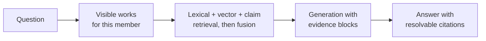

Status: active
Owner: product owner
Last verified: 2026-08-12
Source of truth: `packages/python/lab_assistant/application/`

# Product overview

Lab AI Assistant answers research questions from a corpus the lab controls, and every
sentence it produces can be traced to a passage someone can open and read.

## What it is for

- **finding evidence** across external literature and approved internal material;
- **recording what a paper actually reported** — numbers with units, conditions,
  strain and construct — as reviewable claims rather than prose;
- **asking questions** and getting answers whose citations resolve to exact spans;
- **exporting** a dataset with the provenance a reviewer or collaborator will demand.

## What it is not for

It does not decide what is true. A model proposes; a human reviews; only reviewed
claims enter a release. It also has no public interface — there is no anonymous
endpoint, and no self-registration.

## The path a question takes

The second box is the one that matters: **what a member may see is decided before
anything is searched**, so a result they cannot open never influences an answer, a
count, or a chart.

## The path evidence takes

A collection defines a scope. Discovery asks sources what exists and stores their
answers immutably. Reconciliation decides which observations describe the same work —
on strong identifiers only. Acquisition obtains the best legally available copy, or
asks a human for one. Parsing produces an addressable rendition. Extraction proposes
claims. Review accepts, corrects, or rejects them. A release freezes the result and is
published under an alias. Only then can it be asked questions.

Each stage is separately inspectable and separately re-runnable. Nothing is discarded
because a later stage failed.

## Vocabulary

"Ingestion" means only the last step: promoting an approved release into serving
indexes. The full glossary is in [terminology](../data-contracts/terminology.md).

Next: [asking and citations](asking-and-citations.md) ·
[collections and releases](collections-and-releases.md) ·
[user roles](user-roles.md) · [review workflows](review-workflows.md) ·
[export guide](export-guide.md)
