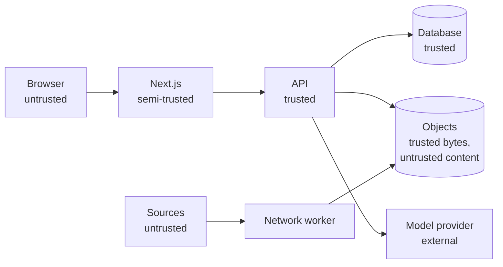

Status: active
Owner: security owner
Last verified: 2026-08-12
Source of truth: `tests/policy/`, `packages/python/lab_assistant/policy/`

# Threat model

Scope: the deployed compose stack, its data, and the material it processes. Assets
worth protecting: workspace-restricted evidence, reviewed claims, member accounts and
sessions, credentials, and the integrity of the audit trail.

## Trust boundaries

**Acquired document content is untrusted for the life of the system.** It is parsed by a
resource-limited worker with no network, and its text reaches a model labelled as data.

## Threats and controls

| # | Threat | Control | Verified by |
|---|---|---|---|
| T1 | A member reads another workspace's evidence | `workspace_id` on every repository method; policy filter before and after ranking; opaque handles | `tests/policy/test_workspace_isolation.py` |
| T2 | Existence inferred from counts, errors, or latency | shared filter for search, counts, **and chunk totals**; withheld sizes limited to release managers; `404` for both absent and invisible | same suite, `tests/policy/test_claim_and_count_filtering.py` |
| T2a | Restricted claims shape a visible ranking | policy predicate applied inside the claim-search SQL, before ranking and truncation | same |
| T2b | Deployment topology read from an unauthenticated endpoint | `/api/v1/config` requires the operations capability | `services/api/tests/test_api.py` |
| T3 | A group-restricted collection reached with a blanket user grant | group restriction requires a group grant or a resource-specific grant | policy unit tests |
| T4 | Stolen session token replayed | short expiry, `httpOnly` same-origin cookie, `auth_epoch` revocation on deactivation | API tests |
| T5 | Prompt injection inside a paper | evidence labelled untrusted, no tools during synthesis, handles validated against what was supplied | generation-citation benchmark |
| T6 | Malicious PDF or workbook | scan then quarantine; no macros; no network in the parse worker; CPU, memory, and size caps | acquisition tests |
| T7 | SSRF through an acquisition URL | https only, host allowlist, no cross-host redirect, size and time caps | connector contract test |
| T8 | Restricted content sent to an external model | policy at task creation **and** immediately before the call; local fallback | model-transfer tests |
| T9 | Secret committed or logged | pre-commit and full-history CI scanning; structured-log redaction; config rejects secret-shaped keys | CI |
| T10 | Formula injection in an export | leading `=`, `+`, `-`, `@`, tab, CR escaped | export tests |
| T11 | Audit trail altered to hide an action | per-workspace hash chain; PostgreSQL trigger refusing update and delete | audit tests |
| T12 | Tampered asset served as evidence | digest verified on read | object-store tests |
| T13 | One tenant starves the queue | per-stage concurrency caps in the database, not per replica | task engine tests |
| T13a | Scaling workers multiplies the request rate at a source | stored, row-locked rate budgets acquired per request; upstream `Retry-After` shared | `tests/integration/test_rate_limit.py` |
| T15 | A worker action attributed to the workspace rather than a person | `tasks.actor_id` is durable; execution refuses a task with no actor | `tests/integration/test_task_actor_identity.py` |
| T16 | Shared bytes carry the wrong work's rights decision | asset rows unique per (workspace, digest, work, manifestation) | `tests/integration/test_asset_provenance.py` |
| T14 | Restored backup loses the audit chain | chain verified as part of restore validation | restore drill |

## Accepted risks

**A trusted admin can read everything in their workspace.** Mitigation is the audit
trail, not prevention.

**A model provider sees content policy permitted.** That is the deliberate trade of
using one; the alternative is a local model, which the policy supports.

**Single-VM availability.** No high availability in the supported profile. Recovery is
backup and restore, and the restore is drilled.

## Out of scope

Physical VM security, the institutional IdP itself, and the browser's own integrity.
